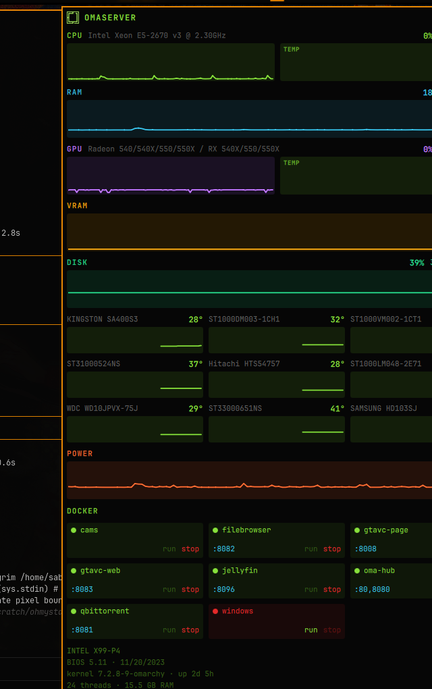

# Omaserver

Stats from a LAN box on the [Omarchy](https://omarchy.org/) bar. The chip is
icon-only (green / black / red). Click it for charts, per-disk temperatures and
a Docker grid with run/stop.

SSH is `server@omaserver` by default (BatchMode). The poll script pipes
`host-stats.py` over SSH — nothing is installed on the server.

<p align="center">
  
</p>

## Install

```bash
omarchy plugin add https://github.com/Gedankenn/omaserver.git --enable
```

Needs working SSH as the configured user (`server` by default), in the `docker`
group on the box if you want container rows.

## Use

| Input | Action |
| --- | --- |
| Left click | Open popup |
| Middle click | Refresh now |

CPU / GPU / RAM: usage chart beside temperature when a sensor exists.

DISK: used space on a full-width chart, then a 3-column grid of each drive
(name, current °C, sparkline). SATA temps come from UDisks2 SMART when sysfs
hwmon is missing.

DOCKER: 3-column cards with status, published HTTP port, **run** / **stop**.
The `windows` container is compose-owned and calls
`/home/server/.local/bin/oma-win`.

History lives in `$XDG_RUNTIME_DIR/sabinho.omaserver.<host>.hist.json` for the
session. A reboot clears it.

## Settings

| Key | Default | Meaning |
| --- | --- | --- |
| `host` | `omaserver` | SSH hostname |
| `user` | `server` | SSH user |
| `refreshSeconds` | `5` | Poll interval |

## License

MIT
